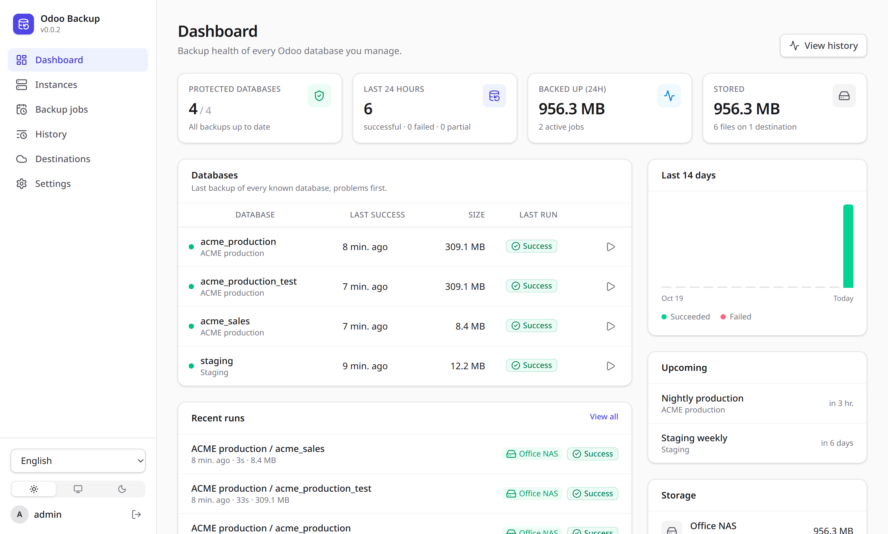
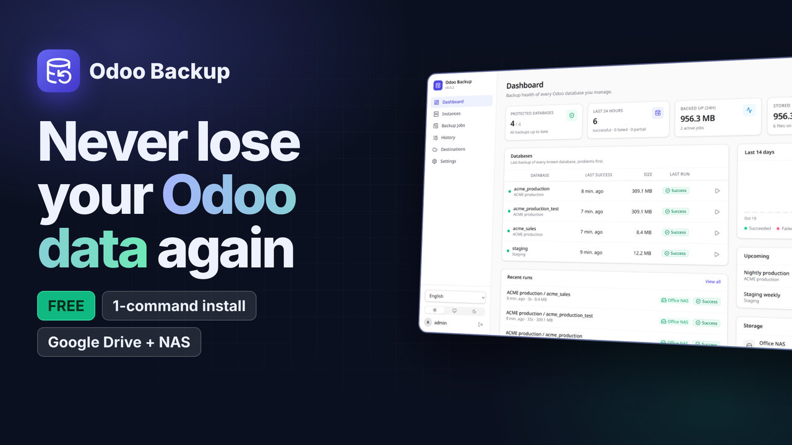
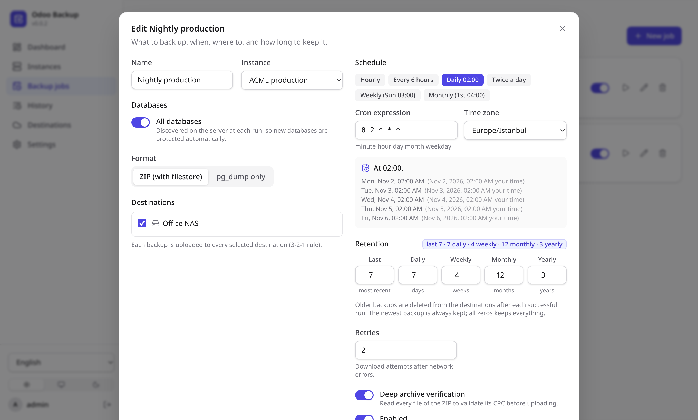
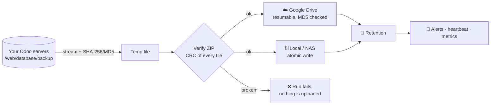
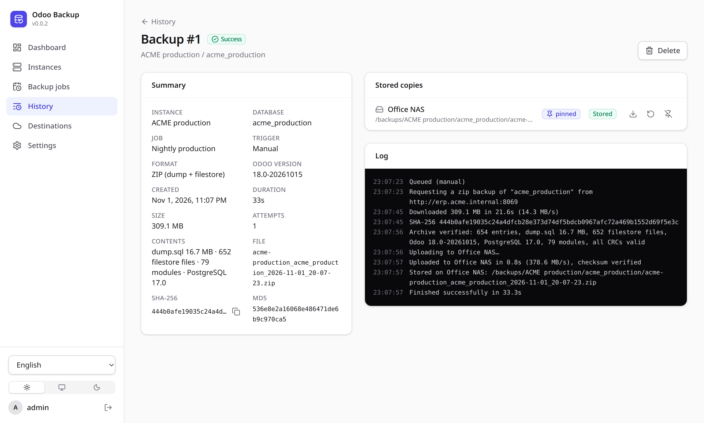
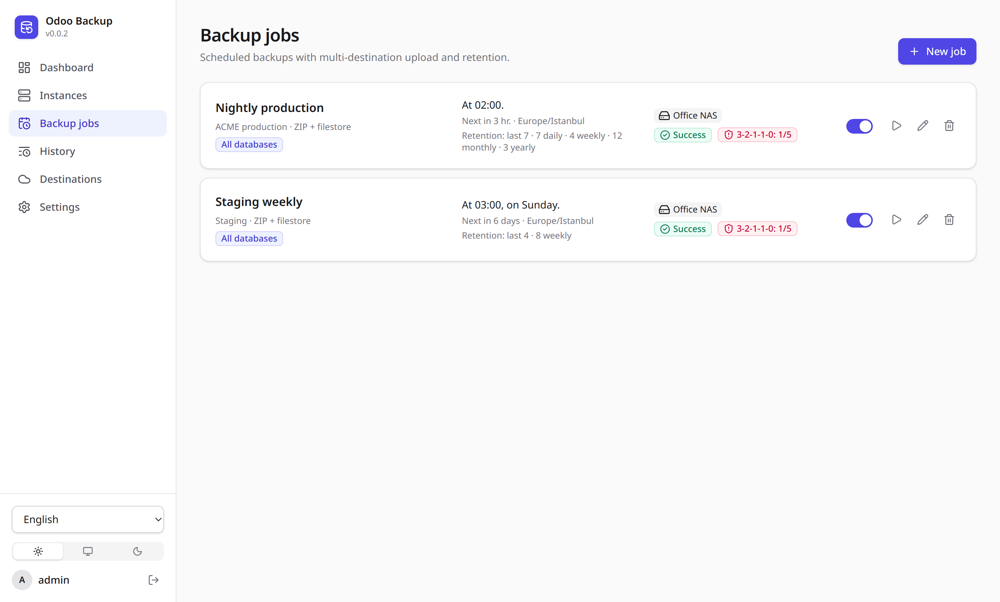
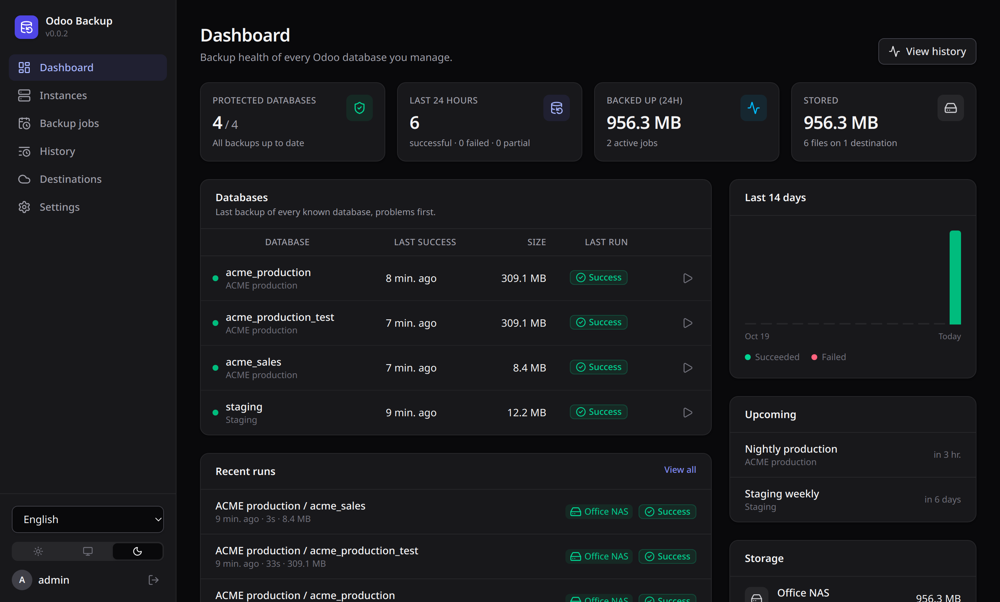
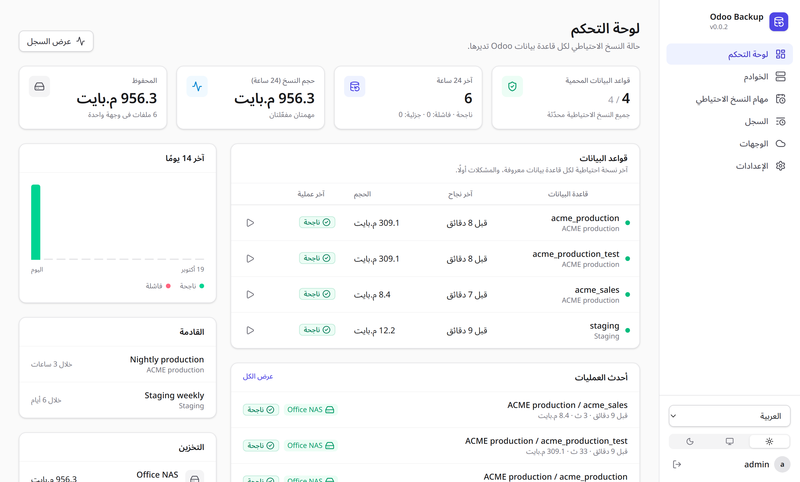

<div align="center">


# Odoo Backup

**Automated, verified backups of every Odoo database, to Google Drive and your own storage.**<br>
Set it up in five minutes. Sleep better for years.

[](https://github.com/101t/odoo_drive_backup/actions/workflows/ci.yml)
[](https://github.com/101t/odoo_drive_backup/releases)
[](LICENSE)
[](https://github.com/101t/odoo_drive_backup/pkgs/container/odoo-backup)
[](#-install-in-one-command)

[**Install**](#-install-in-one-command) · [**Watch the tour**](#%EF%B8%8F-watch-the-4-minute-tour) · [**Features**](#-everything-you-need-nothing-you-dont) · [**Docs**](docs/README.md) · [**Contribute**](#-contributing)



</div>

---

## 💡 Why Odoo Backup?

Your Odoo database *is* your business: invoices, customers, stock, payroll. Odoo's **Backup** button works, but
only when someone remembers to click it, and only if someone checks that the file is not broken and puts it
somewhere safe.

Odoo Backup does that for you, every night, for every database on every server:

- ✅ **It just works with your Odoo.** No addon to install: it uses Odoo's own database manager, like the Backup
  button. Odoo 12 and newer, Community and Enterprise, any number of servers.
- 🔍 **Every backup is verified.** Each ZIP is opened and every file is checked before it leaves the server, and
  checksums are compared again at the destination.
- ☁️ **Off-site by default.** Google Drive and a local disk or NAS, in parallel, with smart retention.
- 🔔 **You hear about problems.** Slack, Discord, Telegram, e-mail or a heartbeat monitor, even when the server
  itself goes down.
- ♻️ **Restore in one click,** into a new database, so testing your backups is safe.

It is a single ~20 MB program (Rust + React) with a web dashboard. Free and open source under the MIT license.

## 🚀 Install in one command

<table>
<tr><td>

**🐧 Linux server** (Debian, Ubuntu, RHEL, Rocky, Alma, Fedora, openSUSE, Arch · x86_64 and ARM64)

```bash
curl -fsSL https://github.com/101t/odoo_drive_backup/releases/latest/download/install.sh | sudo sh
```

Picks the right package for your distribution, verifies its checksum and starts the `odoo-backup` service.
Run it again to upgrade.

</td></tr>
<tr><td>

**🐳 Docker**

```bash
docker run -d --name odoo-backup --restart unless-stopped -p 8080:8080 \
  -v odoo-backup-data:/data -v odoo-backup-files:/backups \
  ghcr.io/101t/odoo-backup:latest
```

</td></tr>
<tr><td>

**🪟 Windows Server.** Download `odoo-backup-<version>-x86_64-windows.zip` from the
[latest release](https://github.com/101t/odoo_drive_backup/releases/latest), extract it, and in an Administrator
PowerShell:

```powershell
powershell -ExecutionPolicy Bypass -File .\install.ps1 -OpenFirewall
```

</td></tr>
</table>

Then open **`http://<your-server>:8080`** and create your admin account. That's it. 🎉

> [!IMPORTANT]
> Keep a copy of `secret.key` (in `/var/lib/odoo-backup`, the `/data` volume, or `C:\ProgramData\OdooBackup`).
> It decrypts the stored Odoo master passwords and Google credentials.

Offline servers, Docker Compose, PostgreSQL, upgrades and uninstalling: see the [installation guide](docs/install.md).

## ▶️ Watch the 4-minute tour

<a href="https://www.youtube.com/watch?v=kdak4Opv-dw">
  
</a>

How it works, the one-line install, and a real backup and restore from start to finish.

## 🧭 Three steps to fully automated backups

| | Step | In the app |
|---|---|---|
| **1** | **Connect your Odoo server** | *Instances → Add instance*: the URL and the master password. *Test connection* shows the Odoo version and finds the databases. |
| **2** | **Choose where backups go** | *Destinations → Add destination*: [Google Drive](docs/google-drive.md) or a local / NAS folder. *Test* writes and deletes a small file to prove it works. |
| **3** | **Schedule a job** | *Backup jobs → New job*: pick the databases (or *All databases*), a schedule, destinations and how many copies to keep. Press ▶ to run it right away. |

<div align="center">

</div>

> [!TIP]
> Your Odoo server needs the database manager enabled (`list_db = True`, the default) and, for large databases, a
> higher `limit_time_real` and proxy timeout. See [Odoo requirements](docs/configuration.md#odoo-requirements).

## ✨ Everything you need, nothing you don't

| | |
|---|---|
| 🔌 **Any Odoo, no addon**<br>Odoo 12+, Community and Enterprise, on-premise or self-hosted. Databases are discovered automatically, and *All databases* protects new ones as they appear. | 🛡️ **Verified before shipping**<br>Streamed to disk (never held in memory) with SHA-256 and MD5. Every ZIP entry's CRC is checked, `dump.sql` and `manifest.json` must be present. |
| ☁️ **Google Drive done right**<br>Resumable uploads survive dropped connections, and Drive's MD5 is compared with the local one. Service account in a Shared Drive, or your own account in two clicks. | 🗄️ **Several destinations at once**<br>Drive + NAS in parallel. Each job gets a **3-2-1-1-0 score** with hints on what is missing. |
| 📅 **Schedules that make sense**<br>Cron presets with time zones and a preview of the next runs. A run missed while the server was off runs at startup. | 🧹 **Smart retention**<br>Keep the last *N* plus daily, weekly, monthly and yearly copies. **Pin** a backup ("before upgrade") to keep it forever. |
| ♻️ **One-click restore**<br>Into a new database on any server, with *copy* (new UUID) and *neutralize* options. Existing databases are never overwritten. | 📈 **Sanity checks**<br>Dump size, filestore files and modules are compared with the previous backup. A backup that suddenly shrinks is flagged, even if it "succeeded". |
| 🔔 **Alerts and heartbeats**<br>Slack, Mattermost, Google Chat, Discord, Telegram, e-mail, plus healthchecks.io / Uptime Kuma pings and Prometheus `/metrics`. | 🔐 **Secure by default**<br>Secrets encrypted with AES-256-GCM, Argon2id passwords with lockout, HttpOnly sessions. Secrets are never sent back to the browser. |
| 📊 **Live dashboard**<br>Health of every database, live progress bars and throughput, full logs, history and downloads. | 🌍 **Speaks your language**<br>English, العربية (full right-to-left layout), Français, Türkçe and Español. Light and dark mode. |

## 🔍 How it works



A scheduler starts the jobs, an engine runs them (one at a time per Odoo server, several servers in parallel), and
everything is visible live in the web UI. The app keeps its own data in SQLite (zero setup) or PostgreSQL.

## 🖼️ Screenshots

<table>
<tr>
<td width="50%"><br><sub><b>Every run</b>: what is inside the archive, where it is stored, and the full log.</sub></td>
<td width="50%"><br><sub><b>Jobs</b>: schedule, retention, last result and the 3-2-1-1-0 score.</sub></td>
</tr>
<tr>
<td width="50%"><br><sub><b>Dark mode</b>, or follow your system.</sub></td>
<td width="50%"><br><sub><b>Arabic</b> with a full right-to-left layout, plus French, Turkish and Spanish.</sub></td>
</tr>
</table>

## 📚 Documentation

| | |
|---|---|
| [Installation](docs/install.md) | Docker, Compose, Linux and Windows services, offline installs, upgrades, from source |
| [Google Drive setup](docs/google-drive.md) | Service account + Shared Drive, or your own Google account (OAuth) |
| [Configuration](docs/configuration.md) | Environment variables, SQLite or PostgreSQL, Odoo and nginx requirements |
| [User guide](docs/guide.md) | Retention and pinning, restore, alerts, metrics, languages, security, CLI |
| [Development](docs/development.md) | Architecture, local setup, tests, releases, REST API |

## ❓ FAQ

<details>
<summary><b>Do I need to install anything in Odoo?</b></summary>

No. Odoo Backup calls the same database manager endpoint as the *Backup* button on `/web/database/manager`. You
only need the Odoo URL and its master password (`admin_passwd`).
</details>

<details>
<summary><b>Does it work with Odoo Online (odoo.com)?</b></summary>

No. Odoo Online does not expose the database manager. Odoo Backup is for Odoo you run yourself: on-premise, on a
VPS, in Docker, etc.
</details>

<details>
<summary><b>Where are my passwords stored? Are they safe?</b></summary>

Master passwords, Google keys and tokens, webhook URLs and SMTP passwords are encrypted at rest with AES-256-GCM and
are never returned by the API. Put the app behind HTTPS and set `ODB_COOKIE_SECURE=true`. Details in
[Security notes](docs/guide.md#security-notes).
</details>

<details>
<summary><b>Can I restore a backup without Odoo Backup?</b></summary>

Yes. Backups are standard Odoo archives (`dump.sql` + filestore). Download one from the UI or take it from Drive or
your NAS, and restore it with Odoo's own database manager.
</details>

<details>
<summary><b>What happens if the upload to Google Drive is interrupted?</b></summary>

The upload resumes at the exact byte where it stopped. If the session expired, it starts again. The copy only
counts as stored once Drive's MD5 matches the local file.
</details>

<details>
<summary><b>I lost the admin password.</b></summary>

Run `odoo-backup reset-password admin` on the server (in Docker:
`docker exec -it odoo-backup odoo-backup reset-password admin`).
</details>

## 🤝 Contributing

Odoo Backup is built in the open, and every kind of help counts:

- ⭐ **Star the repository**: it helps other Odoo users find it.
- 🐞 **Report a bug or ask for a feature** in [Issues](https://github.com/101t/odoo_drive_backup/issues).
- 🌍 **Translate the UI** into your language: copy one file, translate, open a pull request
  ([how](CONTRIBUTING.md#translations)).
- 🛠️ **Send a pull request**: [CONTRIBUTING.md](CONTRIBUTING.md) covers the setup and the checks.

Found a security problem? Please follow [SECURITY.md](SECURITY.md) instead of opening a public issue.

## 📄 License

[MIT](LICENSE): free for personal and commercial use.

<div align="center">
<sub>Made with 💜, 🦀 Rust and ⚛️ React for everyone who runs Odoo. If it saves your day, tell a friend.</sub>
</div>
